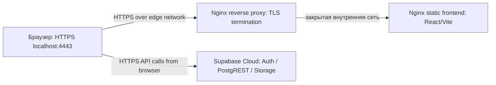

# Практическое занятие 18 — локальный деплой ZhekaFitness

## Цель и границы

Приложение развёрнуто локально в Docker Compose с HTTPS и обратным прокси Nginx. Публичный сервер не настраивался: сайт обращается к проекту Supabase, который содержит реальные учётные данные и пользовательские данные. Внешний сервер, домен и публичный TLS требуют отдельной подготовки инфраструктуры и проверки требований к хранению персональных данных.

## Архитектура



| Сервис | Образ/сборка | Внутренний порт | Порт хоста | Назначение |
| --- | --- | ---: | ---: | --- |
| `nginx` | `nginx/nginx-unprivileged:1.30.6-alpine-slim` | 8080 HTTP, 8443 HTTPS | `127.0.0.1:8081`, `127.0.0.1:4443` | TLS, security headers, проксирование |
| `frontend` | Сборка из `Dockerfile` | 8080 | Не опубликован | Статические файлы приложения |
| Supabase | Управляемый внешний сервис | HTTPS | Внешний API | Авторизация, база и файлы |

Внешние порты Compose привязаны к loopback-адресу. `frontend` подключён только к закрытой внутренней сети; `nginx` подключён к ней и к edge bridge-сети для публикации портов. В контейнерах Nginx работает под непривилегированным пользователем. Только reverse proxy публикует порты хоста.

## Переменные окружения

Compose читает локальный `.env.local` (файл исключён из Git). Для сборки нужны только клиентские переменные:

- `VITE_SUPABASE_URL`
- `VITE_SUPABASE_PUBLISHABLE_KEY`
- `VITE_PUBLIC_SITE_URL` (для локальной сборки: `https://zhekafitness.localhost:4443`)

Не добавляйте `SUPABASE_SECRET_KEY`, service-role key или иные серверные секреты в Vite-переменные или Docker build args. Публичный ключ встраивается в браузер, а доступ к данным ограничивается RLS в Supabase.

## Сертификат и запуск

Один раз установите [mkcert](https://github.com/FiloSottile/mkcert), затем из корня репозитория выполните в PowerShell:

```powershell
Copy-Item .env.example .env.local # если локальный файл ещё не настроен
# Заполните VITE_SUPABASE_URL и VITE_SUPABASE_PUBLISHABLE_KEY в .env.local.
# Укажите VITE_PUBLIC_SITE_URL=https://zhekafitness.localhost:4443.
mkcert -install
New-Item -ItemType Directory -Force deploy/certs | Out-Null
mkcert -cert-file deploy/certs/zhekafitness.localhost.pem -key-file deploy/certs/zhekafitness.localhost-key.pem zhekafitness.localhost
docker compose --env-file .env.local -f deploy/docker-compose.yml up --build -d
docker compose --env-file .env.local -f deploy/docker-compose.yml ps
```

Откройте `https://zhekafitness.localhost:4443`. Локальный HTTP на `http://zhekafitness.localhost:8081` перенаправляет на HTTPS. Если браузер был открыт до установки mkcert CA, перезапустите его.

Проверка логов и остановка:

```powershell
docker compose --env-file .env.local -f deploy/docker-compose.yml logs --tail=100
docker compose --env-file .env.local -f deploy/docker-compose.yml down
```

## Проверка API и заголовков

Приложение является статическим frontend без собственного `/api`. Браузер обращается напрямую к Supabase по HTTPS; запросы авторизации и REST можно увидеть в DevTools → Network, фильтр `Fetch/XHR` (хост Supabase, путь `/auth/v1/` или `/rest/v1/`). Reverse proxy обслуживает HTML, JS, CSS и другие frontend-файлы. Поэтому заголовок `X-Robots-Tag` для ответа API Supabase настраивается на стороне Supabase и не добавлен в Nginx этого проекта. На ответы сайта добавляются CSP, `X-Content-Type-Options`, `X-Frame-Options`, `Referrer-Policy` и `Permissions-Policy`.

Проверить TLS, редирект и заголовки из PowerShell:

```powershell
curl.exe -I http://zhekafitness.localhost:8081
curl.exe -I https://zhekafitness.localhost:4443
```

## CI/CD

Workflow `.github/workflows/ci.yml` выполняет lint, тесты и сборку, а затем проверочную сборку Docker-образа (без публикации) при pull request и push в `main`; доступен также `workflow_dispatch`. При push в `main` образ публикуется в GHCR под `latest` и SHA коммита. Проверка образа использует безопасные тестовые значения, если GitHub Actions Variables не настроены; они не предназначены для запуска приложения. Для публикации рабочего образа должны быть заданы Actions Variables `VITE_SUPABASE_URL`, `VITE_SUPABASE_PUBLISHABLE_KEY`, `VITE_PUBLIC_SITE_URL`.

## Конфликты портов и решение

На машине уже заняты стандартные 80/443 другими локальными Compose-проектами. Они не останавливались. Поэтому приложение использует loopback-порты 8081/4443. Порты 8080 и 8443 доступны только внутри Compose-сети. Если указанные локальные порты заняты, поменяйте левую часть mappings в `deploy/docker-compose.yml`.

## Что изменить для настоящего сервера

1. Подготовить Linux-хост, домен и DNS A/AAAA записи; настроить firewall только для необходимых портов.
2. Использовать публично доверенный сертификат (например, ACME/Let's Encrypt) и автоматическое продление; не переносить локальный mkcert CA в production.
3. Настроить production `VITE_PUBLIC_SITE_URL`, Supabase Auth Site URL/redirect allowlist, CSP и CORS.
4. Проверить требования к размещению и обработке пользовательских данных, резервные копии и мониторинг.
5. Развернуть образ из GHCR и включить контролируемое обновление после успешного CI. Секретные ключи хранить в менеджере секретов сервера, не в frontend-сборке.

## Снимки и подтверждения

- `screenshots/local-https-page.png` — фактическая страница приложения, отрендеренная Chrome из локального HTTPS endpoint.
- `screenshots/compose-ps.txt` — фактический вывод `docker compose ps`; видны только опубликованные loopback-порты прокси.
- `screenshots/https-headers.txt` — фактический ответ HTTPS с HTTP 200 и security headers.

Запросы Supabase выполняются браузером напрямую; доступность проекта и заголовки API можно дополнительно исследовать во вкладке Network. Приватный ключ сертификата не включён в эти материалы: он остаётся в `deploy/certs/` и исключён из Git.
