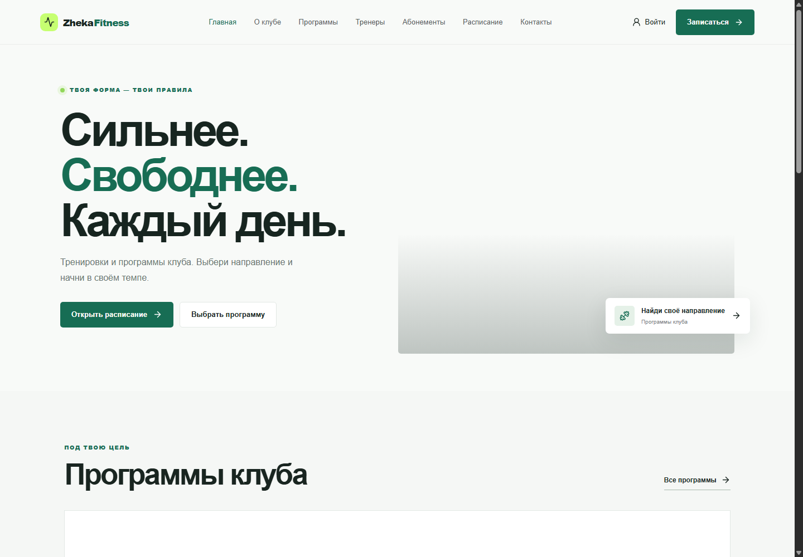
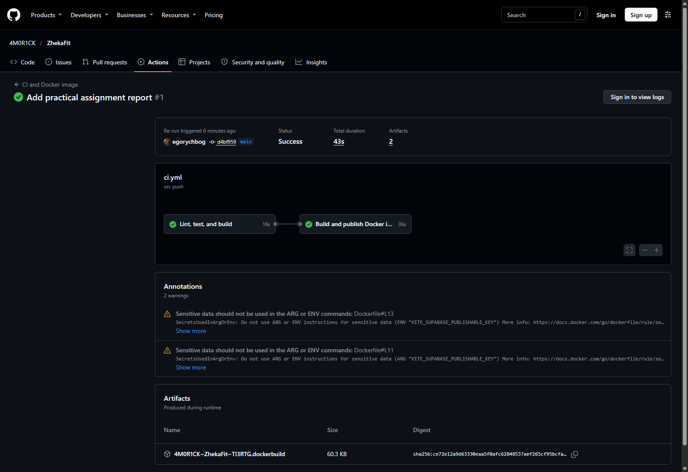

# Практическое занятие 15

## Автоматизация сборки и деплоя проекта через GitHub Actions и Docker

Фамилия: ____________________  
Группа: ____________________  
Вариант: ____________________  
Дата: 20 ноября 2026 г.

## Цель работы

Подготовить веб-приложение ZhekaFitness к запуску в Docker и настроить GitHub Actions для проверки проекта, сборки контейнера и публикации образа в GitHub Container Registry.

## Структура проекта

Проект использует React, TypeScript и Vite. Production-сборка Vite копируется в Nginx-контейнер. Nginx обслуживает статические файлы и возвращает `index.html` для клиентских маршрутов приложения.

Для этого созданы `Dockerfile`, `.dockerignore` и `nginx.conf`. Dockerfile собирает приложение на `node:22-alpine`, затем копирует результат в `nginx:alpine`. Контейнер слушает порт 8080. Файл `.dockerignore` исключает `.env` файлы, локальные зависимости, артефакты сборки и неиспользуемые в образе файлы.

## Локальная сборка и запуск Docker

Для сборки используются публичные настройки Supabase, которые приложение включает в браузерный код:

```powershell
$env:VITE_SUPABASE_URL = "https://<project-ref>.supabase.co"
$env:VITE_SUPABASE_PUBLISHABLE_KEY = "<publishable-key>"
docker build --build-arg VITE_SUPABASE_URL --build-arg VITE_SUPABASE_PUBLISHABLE_KEY -t zhekafitness:local .
docker run --name zhekafitness -d -p 8080:8080 zhekafitness:local
docker ps
```

Приложение доступно по адресу `http://localhost:8080`. Контейнер останавливается и удаляется командами:

```powershell
docker stop zhekafitness
docker rm zhekafitness
```

## Автоматизация GitHub Actions

Файл `.github/workflows/ci.yml` запускает lint, тесты и production-сборку при push в `main` и при pull request в `main`. Задача публикации зависит от успешных проверок и выполняется только при push в `main`. Она публикует в GHCR образы `ghcr.io/4m0r1ck/zhekafit:latest` и образ с SHA коммита.

Workflow использует `GITHUB_TOKEN` с правом `packages: write`. Для сборки в настройках репозитория добавлены Actions Variables `VITE_SUPABASE_URL` и `VITE_SUPABASE_PUBLISHABLE_KEY`. Это публичные настройки браузерного приложения. Секретный ключ Supabase в Docker-сборку и репозиторий не передаётся.

## Работа с pull request

1. Создать отдельную ветку `feature/<название>`.
2. Зафиксировать изменения и отправить ветку командой `git push -u origin feature/<название>`.
3. Создать pull request в `main`.
4. Проверить завершение lint, тестов и production-сборки во вкладке **Actions**.
5. После успешного review слить pull request в `main`. Это запускает публикацию Docker-образа.

## Результаты локальной проверки

- `npm run lint` завершился успешно.
- `npm run test`: успешно выполнены 4 теста.
- `npm run build` собрал production-версию. Сборщик сообщил предупреждение о JavaScript chunk размером более 500 КБ.
- Docker-образ `zhekafitness:local` собран.
- Запущенный контейнер вернул успешный ответ для главной страницы и маршрута `/pricing`.
- `.env.local` и отдельный скрипт для постороннего отчёта исключены из Git.

## Результат в GitHub

Проект отправлен в публичный репозиторий [4M0R1CK/ZhekaFit](https://github.com/4M0R1CK/ZhekaFit) в ветку `main`. Workflow [CI and Docker image](https://github.com/4M0R1CK/ZhekaFit/actions/runs/44578824832) завершился успешно: lint, тесты, production-сборка, Docker-сборка и публикация образа в GHCR прошли.

Опубликованы теги `ghcr.io/4m0r1ck/zhekafit:latest` и `ghcr.io/4m0r1ck/zhekafit:d4bf95992d0c8c91a569d437efc72a897d05b0a0`. Реальный запуск workflow доступен по ссылке выше.

Образ `latest` скачан из GHCR и запущен локально. Проверены маршруты `/` и `/pricing`; манифест образа доступен для скачивания без авторизации.

## Скриншоты




